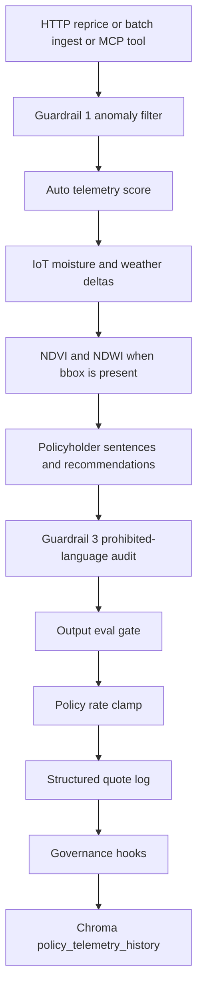

# System architecture

DMUE is a small underwriting core. One pipeline prices a policy. The HTTP API, the MCP server, and the Streamlit workbench all use that pipeline.

## Request path



`app/core/quote.py` owns this sequence. `app/main.py` and `app/mcp_server/server.py` call `quote_policy` and do not score on their own.

## Modules

| Module | Role |
| --- | --- |
| `app/main.py` | FastAPI routes |
| `app/core/quote.py` | Shared quote pipeline |
| `app/core/config.py` | Caps, physical bounds, signal weights, eval thresholds |
| `app/core/guardrails.py` | Anomaly filter, +25% / −20% clamp, prohibited-factor rejection |
| `app/core/risk_engine.py` | Score, multiplier, environment deltas, recommendation text |
| `app/core/satellite_processor.py` | NDVI and NDWI from deterministic bands |
| `app/core/evals.py` | Prohibited-term count, factor coverage, Flesch-Kincaid |
| `app/core/governance.py` | Quote JSON log, audit hook, decision records |
| `app/core/routing.py` | Model routes: rules, full, explain |
| `app/core/cost.py` | Per-quote USD ledger and cost hook |
| `app/core/observability.py` | Local JSONL traces and optional LangSmith export |
| `app/harness.py` | Fixture evaluation harness for the PRD cases |
| `app/core/memory.py` | Chroma persist, hash embedder, policy recall |
| `app/mcp_server/server.py` | JSON-RPC 2.0 tools over stdin/stdout |
| `app/ui/dashboard.py` | Workbench that posts to the API |

## HTTP API

| Method | Path | Body |
| --- | --- | --- |
| GET | `/` | Health payload |
| POST | `/api/v1/reprice` | One telemetry object |
| POST | `/api/v1/ingest` | JSON list. Returns **202** `{job_id, status: queued}` |
| GET | `/api/v1/jobs/{job_id}` | Ingest job `queued`, `running`, `done`, or `failed` |
| GET | `/api/v1/policy/{policy_id}/context` | Optional `limit` query, default 3 |
| GET | `/api/v1/ops/status` | Environment, version, routes, process cost |
| GET | `/api/v1/ops/costs` | Cost ledger for this process |
| GET | `/api/v1/ops/traces` | Recent quote traces |

A quote response includes `risk_score`, `raw_premium`, `final_bounded_premium`, `rate_clamped`, `regulatory_status`, `attribution_reasons`, `recommendations`, `anomalies`, `satellite` (or null), `evals`, `decisions`, and `policy_version`. Invalid sensors, prohibited keys, and failed explanation evals return HTTP 422. `/api/v1/*` returns **429** when the per-process token bucket is empty. A full ingest queue returns **503**. When `DMUE_API_KEY` is set, `/api/v1/*` returns **401** without `X-API-Key` or `Authorization: Bearer`.

## Scoring

Auto behavior starts at 50. Frequent hard braking adds 15, smooth braking subtracts 10, night miles above 25% add 12, and more than two speeding events add 20. The score is clipped to 0–100.

```text
raw_premium = base_premium * (0.7 + risk_score / 100 * 0.8)
```

Default base premium is $120 (`BASE_MONTHLY_AUTO_PREMIUM`).

High moisture (at least 0.85) adds 8. High wind (at least 40 mph) adds 8. Heavy rain (at least 50 mm) adds 6. Weights live in `app/core/config.py`.

If `bbox` is present, vegetation risk is added next: +25 when NDVI is below 0.30, +10 when it is below 0.45, and −15 otherwise. The premium is recalculated from the final score before the rate clamp.

The clamp then limits the move versus `previous_premium` to +25% and −20%.

## Satellite bands

`compute_ndvi` and `compute_ndwi` are the usual normalized differences. `synthesize_bands` maps the box center onto reflectance. Distance is measured from longitude 30.5, latitude 14.5, and reaches a healthy canopy by 8 degrees. The distressed fixture `(30.0, 14.0, 31.0, 15.0)` is the TC-03 box.

`SENTINEL_API_TOKEN` is stored on the result as `sentinel_token_configured`. `sentinel_live_fetch` stays false. The engine does not call Sentinel Hub.

## Guardrails

Guardrail 1 rejects values that cannot be physical (negative miles, night ratio outside 0–1, non-finite numbers, prior premium at or below zero). A hard-brake rate above 20 per 100 miles is a sensor fault. Scoring uses 3.0 instead, which sits between the smooth-braking and frequent-braking bands, and the response records the fault.

Guardrail 3 runs twice. Payload keys in the prohibited set are rejected first. After the sentences are built, the same ideas are scanned as words: gender, race, sex, ethnicity, zipcode, zip code, and credit score. A hit raises before the memory write.

## Evals

`evaluate_explanation` attaches:

- `prohibited_term_leaks` (must be 0)
- `factor_coverage` (matched driver strings / driver count, must be at least 0.50)
- `flesch_reading_ease` (must be at least 60)
- `flesch_grade_level` (must be at most 8)

Coverage uses the factor sentences themselves, so a normal quote covers every driver it produced. The syllable count is local. There is no extra readability package. A failed eval sets `explanation_eval` to `block`, writes a quote log, and does not store the event.

## Controls

Every quote records a `decisions` list. Each item has `layer`, `name`, and `action`.

| Layer | Check | Allow | Other action |
| --- | --- | --- | --- |
| input | `prohibited_keys` | Keys are behavioral | `reject` |
| input | `anomaly_filter` | Values are physical | `flag` for a hard-brake spike, `reject` for impossible values |
| output | `explanation_eval` | Leaks 0, coverage at least 0.50, reading ease at least 60, grade at most 8 | `block` |
| policy | `rate_cap` | Move is inside +25% / −20% | `clamp` |

`policy_version` is `settings.VERSION`. Logger `dmue.quote` writes one JSON line with policy id, `allow` or `block`, score, bounded premium, clamp flag, eval pass, layer actions, and duration in milliseconds.

The HTTP and MCP paths pass `AuditLogHook`. It appends the same event to `AUDIT_LOG_PATH` (default `./data/audit/quotes.jsonl`). Direct `quote_policy` calls used by tests pass no hook. A hook that raises is logged as `block` and skips the memory write.

`python -m app.harness` runs TC-01 through TC-05, the three eval thresholds, and a prohibited-key rejection. Exit code 1 means a case failed.

## Runtime patterns

These stay in the API process. There is no Redis.

| Pattern | Behavior |
| --- | --- |
| Rate limit | Token bucket per client IP, `RATE_LIMIT_PER_MINUTE` (default 60). Health `GET /` is not limited. |
| Queue | `POST /api/v1/ingest` enqueues work. One asyncio worker quotes each event. Cap `INGEST_QUEUE_MAX` (default 100). |
| Cache | TTL dict (`CACHE_TTL_SECONDS`, default 30). Policy context is keyed by `policy_id` and `limit`. Satellite results are keyed by bbox. Context keys are dropped after a successful quote for that policy. |
| Circuit breaker | After `CIRCUIT_FAILURES` (default 3) satellite exceptions, skip satellite for `CIRCUIT_COOLDOWN_SECONDS` (default 30). Telematics still score. Decision `satellite_circuit` / `open`. |
| Horizontal scale | Demo default is one worker (`UVICORN_WORKERS=1`). Chroma writes take a file lock. Do not scale the API until rate limit, cost, traces, and jobs are shared. |

Rate limit, cache, ingest jobs, the cost ledger, and in-memory traces are **per process**. Shared quote history is the Chroma volume on a single node. Do not scale the MCP stdio service.

When `DMUE_API_KEY` is set, `/api/v1/*` (including ops) requires `X-API-Key` or `Authorization: Bearer`. `GET /` is open. Staging and production require a key at process start. `CORS_ALLOW_ORIGINS` is a comma-separated allowlist. Put TLS on a reverse proxy; see [DEPLOY.md](DEPLOY.md).

## Model routing and cost

`model_route` on the quote payload selects a named route. Unknown ids are rejected.

| Route | Signals | Unit USD |
| --- | --- | --- |
| `dmue-rules-v1` | Telemetry math only | 0.0002 |
| `dmue-full-v1` | Environment + satellite (default) | 0.0010 |
| `dmue-explain-v1` | Same signals, reserved explanation cost | 0.0015 |

Satellite that actually runs adds **0.0005**. `CostHook` appends allow-events to `data/audit/costs.jsonl`. The console sidebar shows process `total_usd`.

## Environment and CI

`DMUE_ENV` is `local`, `staging`, `production`, or `ci`. Copy `env.example` to `.env`. GitHub Actions workflow `.github/workflows/ci.yml` installs dependencies, runs pytest, and runs the harness.

## Memory

`PolicyMemoryManager` opens a persistent Chroma client. The collection name is `policy_telemetry_history`. The default directory is `./data/chroma_db`.

`HashEmbeddingFunction` (`dmue_hash`) embeds each document as 32 floats from SHA-256. Recall is `collection.query` with `where={"policy_id": policy_id}`. Document ids look like `POL-98234_<16 hex chars>`. Metadata is `policy_id`, `risk_score`, and `premium` (the bounded premium).

Tests pass a temporary directory into the constructor. The API and MCP server share one client per process and path.

## MCP

The server reads one JSON-RPC object per stdin line and writes one response per line.

| Tool | Purpose |
| --- | --- |
| `reprice_policy_micro_underwrite` | Same quote pipeline as HTTP, including the memory write |
| `get_policy_context` | Recall for one `policy_id` |

`tools/list` and `tools/call` are the supported methods. A successful tool result uses `result.content[0].text` with a JSON string. The reprice payload includes `final_bounded_premium` plus the older aliases `calculated_risk_score`, `raw_calculated_premium`, `regulatory_notes`, and `primary_risk_drivers`.

## Processes

`docker-compose.yml` builds one image from the multi-stage `Dockerfile` and runs three services:

| Service | Command | Port |
| --- | --- | --- |
| `dmue-api` | `uvicorn ... --workers ${UVICORN_WORKERS:-1}` | 8000 |
| `dmue-dashboard` | Streamlit on 8501 | 8501 |
| `dmue-mcp` | `python -m app.mcp_server.server` | stdin/stdout |

The API mounts `./data` at `/app/data` and sets `CHROMA_PERSIST_DIR=/app/data/chroma_db`. The dashboard sets `DMUE_API_URL=http://dmue-api:8000` so the browser app reaches the API service instead of the container's own loopback. Locally the dashboard defaults to `http://127.0.0.1:8000`.

The image is `python:3.11-slim` and runs as uid `10001` (`dmue`). Dependencies install in a builder stage and copy into the runtime stage, which also installs `libgomp1` for the numerical stack. The API healthcheck calls `GET /`. Production overlay `docker-compose.prod.yml` binds ports to `127.0.0.1` and requires `.env` with `DMUE_API_KEY`. MCP is Compose profile `mcp`. Chroma remains a local directory on a single node.
sequenceDiagram
  actor UW as Underwriter
  participant WB as Workbench
  participant API as FastAPI
  participant Q as quote_policy
  participant DB as Chroma

  UW->>WB: Policy id, prior premium, driving, home, weather, optional box
  WB->>API: POST /api/v1/reprice
  Note over WB,API: Night % and moisture % become fractions. No gender, race, ZIP, or credit fields.

  alt Prohibited key or impossible sensor
    API-->>WB: HTTP 422
    WB-->>UW: Rejection message. Nothing is stored.
  else Quote accepted
    API->>Q: Cleaned telemetry
    Q->>Q: Score, sentences, language audit, rate clamp
    Q->>DB: policy_id, risk score, bounded premium, factor text
    Q-->>API: Premium, score, reasons, actions, anomalies, evals
    API-->>WB: Quote JSON
    WB->>API: GET /api/v1/policy/{id}/context
    API->>DB: Recall by policy_id
    DB-->>WB: Prior premiums and scores
    WB-->>UW: Price, score, cap status, factors, actions, trend
  end
