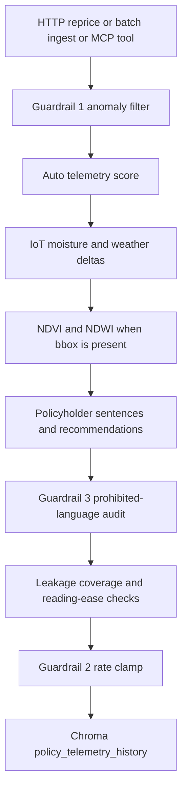

# System architecture

DMUE is a small underwriting core. One pipeline prices a policy. The HTTP API, the MCP server, and the Streamlit workbench all use that pipeline.

## Request path



`app/core/quote.py` owns this sequence. `app/main.py` and `app/mcp_server/server.py` call `quote_policy` and do not score on their own.

## Modules

| Module | Role |
| --- | --- |
| `app/main.py` | FastAPI routes |
| `app/core/quote.py` | Shared quote pipeline |
| `app/core/config.py` | Caps, physical bounds, signal weights, eval thresholds |
| `app/core/guardrails.py` | Anomaly filter, +25% / −20% clamp, prohibited-factor rejection |
| `app/core/risk_engine.py` | Score, multiplier, environment deltas, recommendation text |
| `app/core/satellite_processor.py` | NDVI and NDWI from deterministic bands |
| `app/core/evals.py` | Prohibited-term count, factor coverage, Flesch-Kincaid |
| `app/core/memory.py` | Chroma persist, hash embedder, policy recall |
| `app/mcp_server/server.py` | JSON-RPC 2.0 tools over stdin/stdout |
| `app/ui/dashboard.py` | Workbench that posts to the API |

## HTTP API

| Method | Path | Body |
| --- | --- | --- |
| GET | `/` | Health payload |
| POST | `/api/v1/reprice` | One telemetry object |
| POST | `/api/v1/ingest` | JSON list of telemetry objects |
| GET | `/api/v1/policy/{policy_id}/context` | Optional `limit` query, default 3 |

A quote response includes `risk_score`, `raw_premium`, `final_bounded_premium`, `rate_clamped`, `regulatory_status`, `attribution_reasons`, `recommendations`, `anomalies`, `satellite` (or null), and `evals`. Invalid sensors and prohibited keys return HTTP 422.

## Scoring

Auto behavior starts at 50. Frequent hard braking adds 15, smooth braking subtracts 10, night miles above 25% add 12, and more than two speeding events add 20. The score is clipped to 0–100.

```text
raw_premium = base_premium * (0.7 + risk_score / 100 * 0.8)
```

Default base premium is $120 (`BASE_MONTHLY_AUTO_PREMIUM`).

High moisture (at least 0.85) adds 8. High wind (at least 40 mph) adds 8. Heavy rain (at least 50 mm) adds 6. Weights live in `app/core/config.py`.

If `bbox` is present, vegetation risk is added next: +25 when NDVI is below 0.30, +10 when it is below 0.45, and −15 otherwise. The premium is recalculated from the final score before the rate clamp.

The clamp then limits the move versus `previous_premium` to +25% and −20%.

## Satellite bands

`compute_ndvi` and `compute_ndwi` are the usual normalized differences. `synthesize_bands` maps the box center onto reflectance. Distance is measured from longitude 30.5, latitude 14.5, and reaches a healthy canopy by 8 degrees. The distressed fixture `(30.0, 14.0, 31.0, 15.0)` is the TC-03 box.

`SENTINEL_API_TOKEN` is stored on the result as `sentinel_token_configured`. `sentinel_live_fetch` stays false. The engine does not call Sentinel Hub.

## Guardrails

Guardrail 1 rejects values that cannot be physical (negative miles, night ratio outside 0–1, non-finite numbers, prior premium at or below zero). A hard-brake rate above 20 per 100 miles is a sensor fault. Scoring uses 3.0 instead, which sits between the smooth-braking and frequent-braking bands, and the response records the fault.

Guardrail 3 runs twice. Payload keys in the prohibited set are rejected first. After the sentences are built, the same ideas are scanned as words: gender, race, sex, ethnicity, zipcode, zip code, and credit score. A hit raises before the memory write.

## Evals

`evaluate_explanation` attaches:

- `prohibited_term_leaks` (must be 0)
- `factor_coverage` (matched driver strings / driver count, must be at least 0.50)
- `flesch_reading_ease` (must be at least 60)
- `flesch_grade_level` (must be at most 8)

Coverage uses the factor sentences themselves, so a normal quote covers every driver it produced. The syllable count is local. There is no extra readability package.

## Memory

`PolicyMemoryManager` opens a persistent Chroma client. The collection name is `policy_telemetry_history`. The default directory is `./data/chroma_db`.

`HashEmbeddingFunction` (`dmue_hash`) embeds each document as 32 floats from SHA-256. Recall is `collection.query` with `where={"policy_id": policy_id}`. Document ids look like `POL-98234_<16 hex chars>`. Metadata is `policy_id`, `risk_score`, and `premium` (the bounded premium).

Tests pass a temporary directory into the constructor. The API and MCP server share one client per process and path.

## MCP

The server reads one JSON-RPC object per stdin line and writes one response per line.

| Tool | Purpose |
| --- | --- |
| `reprice_policy_micro_underwrite` | Same quote pipeline as HTTP, including the memory write |
| `get_policy_context` | Recall for one `policy_id` |

`tools/list` and `tools/call` are the supported methods. A successful tool result uses `result.content[0].text` with a JSON string. The reprice payload includes `final_bounded_premium` plus the older aliases `calculated_risk_score`, `raw_calculated_premium`, `regulatory_notes`, and `primary_risk_drivers`.

## Processes

`docker-compose.yml` builds one image from the multi-stage `Dockerfile` and runs three services:

| Service | Command | Port |
| --- | --- | --- |
| `dmue-api` | `uvicorn app.main:app --host 0.0.0.0 --port 8000` | 8000 |
| `dmue-dashboard` | Streamlit on 8501 | 8501 |
| `dmue-mcp` | `python -m app.mcp_server.server` | stdin/stdout |

The API mounts `./data` at `/app/data` and sets `CHROMA_PERSIST_DIR=/app/data/chroma_db`. The dashboard sets `DMUE_API_URL=http://dmue-api:8000` so the browser app reaches the API service instead of the container's own loopback. Locally the dashboard defaults to `http://127.0.0.1:8000`.

The image is `python:3.11-slim`. Dependencies install in a builder stage and copy into the runtime stage, which also installs `libgomp1` for the numerical stack.
